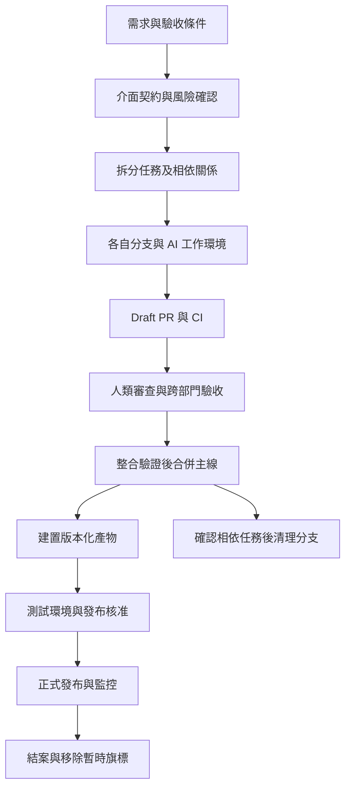

# AI 與 Git 協作軟體研發實務

[English overview](README.md)

研究日期：2026-10-18。適用於多人團隊、跨部門產品研發與 AI 輔助開發；以 GitHub 示範，也比較 GitLab 與 Azure DevOps。以下流程、分工與時限是可調整的建議制度，官方產品行為另附來源；不假定任何廠商工具能保證提升生產力。

建議起點是：**一項可驗收任務、一個負責人、一個短期分支、一個 PR；主線維持可發布，AI 在受限制的工作環境執行，人類負責驗收及發布決策。** 跨部門靠共同需求、介面契約與審查責任整合，不為每個部門永久建立一條分支。

## 閱讀入口

| 文件 | 解決的問題 |
| --- | --- |
| 本頁 | 工具分工、團隊制度、從需求到發布的完整案例 |
| [分支生命週期與操作手冊](research/01-branch-lifecycle.zh-TW.md) | 何時建立、保留、合併、刪除與復原；squash、worktree、hotfix |
| [AI 協作與平台設定](research/02-ai-governance-and-platforms.zh-TW.md) | AI 任務交接、GitHub 閘門、跨部門權限、產品選擇 |
| [可複用工作範本](templates/workflow-templates.zh-TW.md) | Issue、PR、AI 任務單、CODEOWNERS、發布及清理檢查表 |
| [來源與查證範圍](research/03-sources.zh-TW.md) | 官方文件、證據範圍、導入前待確認事項 |

## 先分清楚各種工具負責什麼

Git 管理版本歷史；分支是指向 commit 的可移動名稱。GitHub 等平台把遠端儲存庫、需求、PR 審查、權限與 CI 串起來。AI 可以在這個流程中協助理解、實作、測試與審查，但工作成果仍須進入同一套版本與驗收制度。

| 層次 | 建議用途 | 應留下的紀錄 |
| --- | --- | --- |
| 需求追蹤 | 使用 GitHub Issues／Projects，或公司既有工單系統 | 需求、負責人、驗收條件、相依任務 |
| 決策與規格 | 儲存庫內設計文件、ADR、API schema；必要時連外部設計文件 | 決策原因、介面版本、尚未決定事項 |
| 版本管理 | Git；每人自己的 clone，單機多任務可用 worktree | commit、分支、tag |
| 審查與整合 | GitHub PR、GitLab MR 或 Azure Repos PR | diff、討論、核准與測試結果 |
| 自動驗證 | CI 建置、單元測試、契約測試、整合測試與安全掃描 | 對應 SHA 的結果及測試輸出 |
| 發布與營運 | 版本化產物、部署流程、監控、回復程序 | 產物 digest、環境、版本、部署人與時間 |
| AI 助手 | 規格草稿、局部程式修改、測試草稿、差異檢查 | 使用範圍、人工核對、執行證據 |

GitHub flow 官方流程涵蓋分支、提交、PR、審查、合併與完成後刪除分支；可作為本研究的最小骨架。[GitHub flow](https://docs.github.com/en/get-started/using-github/github-flow)

## 依團隊需求選擇分支策略

人數只是背景，真正的選擇條件是發布頻率、同時支援幾個版本、變更耦合程度與驗證成本。

| 情境 | 建議結構 | 主要取捨 |
| --- | --- | --- |
| 單一線上產品，持續部署 | `main` 加短期任務分支 | 小批次整合；未完成能力須可隱藏或停用 |
| 多部門共同維護一個產品 | 同上，加模組 owner、契約測試及必要的整合佇列 | 增加治理，不必增加長期部門分支 |
| 桌面軟體、設備軟體或多個客戶版本 | `main` 加受支援版本的 `release/x.y` | 需要明確 backport、停止支援日期與版本測試 |
| 有固定封版期，下一版仍持續開發 | 從已知 SHA 切 release 分支穩定化 | release 只收必要修正，防止成為第二條任意開發主線 |
| 已有 `develop` 的成熟流程 | 先確認它是否真的隔離發布需求 | 若只增加等待與重複合併，可逐步簡化；不為改名而遷移 |

Trunk-based development 強調頻繁回到主線；它可以搭配短期分支與 PR。GitHub flow 則描述平台上的協作步驟。兩者不是必須二選一。傳統 Gitflow 的多條長期分支只有在版本管理收益大於合併成本時才值得採用；這是本研究的流程判斷，不是產品限制。

建議任務拆到一至三個工作天能完成第一次可審查版本。這是初始管理目標，不是逾期即刪除的規則；大型任務用小 PR、feature flag 與相容性改造逐步整合。功能旗標須記錄 owner、預設值、測試組合與移除期限，否則會累積新的維護成本。

## 跨部門如何共同負責

每個交付項目指定一名整合負責人，處理相依性與阻塞；各部門仍對自己的專業決策負責。AI 不是責任歸屬的替代者。

| 決策或產物 | 主要負責人 | 必要參與者 | 完成證據 |
| --- | --- | --- | --- |
| 問題與驗收條件 | 產品負責人 | 客服、設計、工程 | 可測試的使用情境及排除範圍 |
| API 與資料格式 | 技術 owner | 前端、後端、資料團隊 | 契約、相容性規則、版本策略 |
| 程式修改 | PR 作者 | AI 可協助，模組 owner 審查 | 可解釋的 diff 與測試 |
| 跨服務整合 | 整合負責人 | 各服務 owner、QA | 已知版本組合的整合結果 |
| 隱私與權限行為 | 資安或相關 owner | 產品、後端 | 負面測試與必要簽核 |
| 發布與事故處置 | 發布負責人／維運 | QA、服務 owner | 版本清單、監控與回復方式 |

非工程部門不必學會 rebase；需求可透過工單、設計稿與預覽環境回饋。重要驗收結果寫回工單或 PR，避免只存在聊天訊息。工程師把決定轉成版本化規格，不能把一段聊天截圖當成永久唯一需求。

建議以工作日一日內首次回覆為審查服務目標，並設代理 owner。阻塞超過目標時先縮小 PR、調整 reviewer 或升級決策；不要讓 AI 不斷新增 PR 掩蓋審查瓶頸。

## 從需求到發布的具體案例

假設要增加「企業客戶匯出訂單 CSV」功能，產品、前端、後端、資安、QA 與維運共同交付。以下是建議演練情境，不是任何公司的實際紀錄。

### 第一步將需求寫成可以驗收的條件

產品建立 Epic，指定交付 owner。驗收至少包含：哪種角色能匯出、資料是否依租戶隔離、日期與時區、最大筆數、逾時處理、欄位格式、稽核紀錄與錯誤提示。QA 提前補入空資料、跨租戶、超量與權限不足案例。AI 可找出需求缺漏，由產品及工程確認後才實作。

### 第二步先處理跨部門契約

後端與前端共同審查 API schema、狀態碼、下載流程及測試 fixture。資安確認授權、資料遮罩及 CSV 公式注入風險如何處理。把契約變更作成小 PR 先合併，後續前後端能各自從新主線開始；若做不到，明列相依 PR，不能假設兩條分支稍後自然相容。

### 第三步拆成可以分別合併的任務

| 任務 | 分支例 | 負責與驗證 |
| --- | --- | --- |
| 契約及測試資料 | `feature/421-export-contract` | 前後端共同確認 schema |
| 後端匯出服務 | `feature/422-export-api` | 後端 owner；權限、限制與串流測試 |
| 前端入口與狀態 | `feature/423-export-ui` | 前端 owner；以契約 fixture 開發 |
| 端到端測試 | `test/424-export-e2e` | QA／工程；真實測試環境驗證 |
| 監控及部署設定 | `ops/425-export-monitoring` | 維運 owner；告警與關閉旗標演練 |

AI 可分別協助任務，但每個任務只有一個目前寫入者。其他人或 AI 提交建議、獨立 PR 或明確交接後接手，避免多個 agent 同時覆寫同一工作目錄。

### 第四步提早建立 Draft PR

作者寫明需求、變更邊界、測試方式及 AI 協助範圍。CI 執行建置、靜態檢查、測試與契約驗證。尚未實作的測試不得用空成功檢查冒充；AI 宣稱測試通過時，作者須確認命令、退出碼、測試數量與對應 commit。

### 第五步讓審查對準實際風險

一般功能由獨立 reviewer 審查；資料匯出另外需要資安要求的驗收。前端與後端各自測試通過不代表整合通過，還須以同一組可追溯版本驗證權限、格式及大資料量行為。修改程式後重新確認核准是否仍適用。

### 第六步合併與發布分開管理

整合負責人按契約、後端、前端等依賴次序合併；高流量儲存庫可使用 merge queue。主線產生版本化產物，測試環境通過後將相同產物提升到正式環境，記錄 SHA、tag、產物 digest 及設定版本。功能旗標先關閉，逐步開放並觀察錯誤率、延遲與匯出失敗率。

資料庫若有修改，採「先擴充相容 schema、部署可相容程式、遷移資料、最後移除舊欄位」的步驟。單純把程式回到舊版不會自動回復資料；發布前分別說明程式回復、資料修復與不可逆動作。

### 第七步結案與清理

已合併且沒有下游依賴的任務遠端分支可刪除，不必等正式發布。發布的追溯依據是版本及產物紀錄。若仍有 PR 以它為 base，先調整依賴並重新驗證，再刪除。每個人另行清理本機分支與 worktree；產品驗收、發布觀察完成後關閉交付項目。

## Monorepo 與多個 repository

| 選擇 | 適合情境 | 必須處理的成本 |
| --- | --- | --- |
| Monorepo | 模組常同步變更、需要一個 PR 原子修改契約與實作 | CI 選擇性執行、owner 分工、較大的讀取範圍 |
| 多 repo | 服務可獨立發布、存取隔離要求不同、責任邊界穩定 | 跨 repo 變更無法靠單一 PR 原子合併；需要版本化契約與組合測試 |

部門數不是拆 repo 的充分理由。若部門 A 不得讀部門 B 原始碼，應採儲存庫及身分權限邊界；CODEOWNERS 是審查路由，不是資料夾讀取隔離。

多 repo 案例可先發布向後相容 API，再讓前端切換，最後淘汰舊 API。使用父工單追蹤每個 repo 的 PR 與版本，整合環境保存服務版本清單。不要要求多個 repo 恰好同時合併才能運作。

## 四週導入建議

| 週次 | 執行內容 | 驗收方式 |
| --- | --- | --- |
| 第一週 | 選一個產品與低風險功能；盤點 owner、發布方式與現有分支 | 每條保留分支有用途與 owner；取得導入前基準 |
| 第二週 | 設 PR 與 CI 閘門、工作範本；試行 AI 任務分工 | 一項功能可從需求追溯至部署版本 |
| 第三週 | 演練跨部門契約變更、合併衝突、hotfix 及分支清理 | 能處理失敗測試與回復，沒有遺失工作 |
| 第四週 | 比較耗時、缺陷及總成本；調整規則 | 決定擴大、修改或停止 AI 用法 |

衡量從任務開始到可用版本的時間、PR 等待時間、回復時間、上線缺陷、重工比例，以及 AI 費用加 CI 與人工審查成本。AI 任務和非 AI 任務要按規模與風險分類比較；不能以 commit 數、產生行數或廠商展示速度判定成效。

初始制度可以很小：主線保護、獨立審查、真實 CI、一項任務一個 owner、清楚的分支生命週期。進階佇列、更多自動化與多代理協作，應在基本流程運作後再引入。
