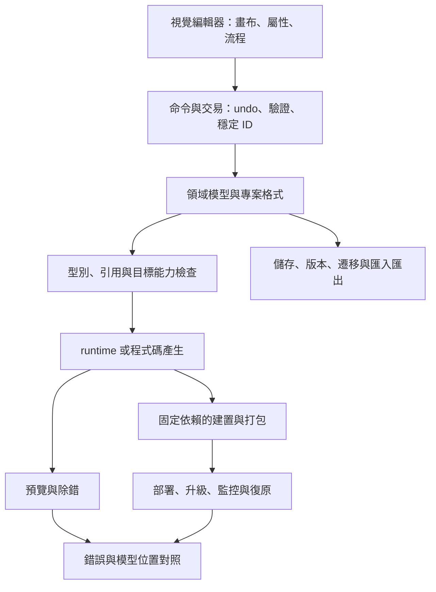

# 共用架構、90 天驗證與商用閘門

[回主報告](../README.zh-TW.md) · [資源模型](02-resources.zh-TW.md) · [領域差異](01-domains.zh-TW.md)

研究日期：2026-10-21。以下為提案與驗收設計，**尚未實作或執行**。90 天用於降低 P0 不確定性，不代表可在 90 天內完成所有領域的商用產品。

## 1. 先固定產品契約

開始前完成一頁範圍表：誰建模、建立什麼應用、執行在哪裡、誰保管資料與密鑰、承諾支援哪些版本、如何離開平台。每項需求應寫成可測場景，例如「使用者可在乾淨工作站開啟舊版專案，升級後建置出可部署產物」，不要只寫「支援版本管理」。

| 必須決定 | 建議 P0 邊界 | 擴大前的證據 |
| --- | --- | --- |
| 領域 | 一種典型任務 | 另一位使用者可重複成功 |
| 目標 | 一個 runtime／OS／板子 | 不同目標的差異與測試成本已量測 |
| 編輯自由度 | 有限元件與流程 | 未支持操作可被清楚拒絕 |
| 自訂程式碼 | 無，或單向生成與明確擴充點 | 安全、版本及覆寫規則通過測試 |
| 部署 | 單機或單租戶一條路徑 | 可重建、可追蹤、可復原 |
| 商業定位 | 一個有付費可能的問題 | 使用者交付證據與價值訪談 |

## 2. 共用核心與領域層

共用核心可處理 ID、命令、存讀及型別規則；領域層負責 tag、量測資料、UI 事件、工作流副作用或場景引用。避免直接把畫布 DOM 當成唯一模型，否則換 UI、遷移或 headless build 會困難。這是本研究架構建議，不是所有現有產品的實作描述。

### runtime 與 codegen 的選擇

| 策略 | 優點 | 新增責任 | 適合先驗證 |
| --- | --- | --- | --- |
| runtime 解讀模型 | 可共用預覽、事件追蹤與部署語意 | runtime 發布、模型相容、隔離及效能 | 流程／模型型應用 |
| 產生一般程式碼 | 可利用既有 compiler、工具及部署 | 依賴固定、格式、source map、自訂區與重新生成 | 原生 UI／MCU／行動 |
| 混合 | 可在部分領域保留靈活性 | 兩種版本契約與除錯路徑 | 明確需要且有實驗支持時 |

預覽應儘量共用正式語意；無法共用的板端／OS 能力必須顯示限制。若允許使用者任意執行程式碼，需另設隔離、資源限制、密鑰與網路邊界，不可在編輯器伺服器主程序直接執行。

## 3. 90 天 P0 驗證

建議投入 2–3 人，領域設備與既有 runtime 已可取得。各時間段為規劃窗口，可依 spike 結果調整；高難領域只驗證其最小子集。

| 時間 | 工作 | 具體驗收 | 決策 |
| --- | --- | --- | --- |
| 第 1–15 天 | 訪談、範圍、依賴與兩項高風險 spike | 一份真實工作流程、3 個目標案例、可用 runtime／分發範圍 | 沒有明確問題或關鍵依賴不適用，改範圍 |
| 第 16–35 天 | 專案模型、ID、命令、基本編輯與存讀 | 3 個固定專案可存讀等價重建；undo／redo 不破壞引用 | 若模型難以表達需求，先修模型 |
| 第 36–55 天 | 執行／生成、建置、錯誤對照 | 編輯後可執行；故意製造錯誤能定位回模型；乾淨環境可建置 | 釐清引擎能力、相容及效能瓶頸 |
| 第 56–75 天 | 整合、復原、舊格式與故障注入 | 中斷存檔不毀舊檔；一版遷移可驗；關鍵失敗有可辨狀態 | 無法復原就不擴大功能 |
| 第 76–90 天 | 外部試用、文件、成本重估 | 至少 3 位目標使用者依文件獨立完成指定任務並記錄卡點 | 決定進 P1、縮小範圍或停止 |

「3 位／3 個」是最低探索樣本提案，無統計代表性。記錄成功率、所需時間、作者介入次數、錯誤原因及預估支援工時；不能只有展示影片。若涉及使用者資料，先用合成資料或取得適當授權的測試集。

## 4. 各領域要加做的關鍵測試

| 領域 | 超越一般畫布展示的必要證據 |
| --- | --- |
| 桌面 IDE | 程式碼生成後保留手寫擴充；元件載入失敗不毀專案；乾淨機器可建置 |
| 網站工具 | 巢狀版面、斷點、鍵盤操作；儲存再開與正式輸出一致；發布可復原 |
| CRUD | 低權限使用者直接呼叫 API 仍被拒絕；跨環境密鑰不進專案匯出 |
| 行動 App | 實機與乾淨建置；native plugin／簽署；承諾離線時測資料衝突 |
| 企業平台 | schema 變更與資料保留；流程升版；角色與審批越權；失敗補償 |
| 流程整合 | worker 在外部副作用完成後、寫回狀態前崩潰；重試不得靜默重複交易 |
| MCU HMI | 真機 Flash／RAM 峰值、frame time 分布、字型／觸控、長時間運作 |
| SCADA | 通訊中斷與恢復、過期值、時間戳、告警狀態；有備援承諾才加入切換測試 |
| 量測 | 已知輸入對照、單位、精度、採樣時間、背壓與資料遺失偵測 |
| 遊戲內容工具 | 資產改名／移動引用、import cache 失效、存讀場景、正式目標匯出 |

效能標準須在目標確定後寫數值：例如硬體與畫面、FPS 或延遲目標、資料率、tags 數、記憶體上限與故障復原時間。本研究不替未知硬體或工作負載編造通用門檻。

## 5. P1 商用前閘門

1. **資料與相容：** 有版本化格式、固定回歸專案、穩定 ID、原子儲存／備份、遷移測試；新格式無法由舊工具安全處理時明確拒絕，避免靜默毀損。
2. **可交付：** 固定依賴與建置環境、可追蹤產物、部署與復原步驟；別人的機器可以重建，並驗證輸出相容。
3. **安全：** 依部署設計確認伺服器授權、密鑰、輸入、腳本、檔案與網路邊界；跨租戶測試僅在承諾多租戶時適用。
4. **可維護：** 錯誤可定位、可取得適當診斷、依賴可更新、支援 owner 有替補，明示支援與停止支援政策。
5. **有使用證據：** 外部使用者依文件交付，追蹤需要工程師代做的比例及支援成本；客製服務與可重用產品收入分開記錄。

這些是驗收設計，並非已達成成果。P2 則另外需要多環境治理、擴充契約、更多版本線與規模／故障測試；只有實際需承諾的功能才列入產品範圍。

## 6. 典型風險與縮小方法

| 風險 | 可觀察訊號 | 縮小或處理方式 |
| --- | --- | --- |
| 為所有領域做通用模型 | 一個元件修改牽動大量互不相干場景 | 一領域優先，跨領域需求有重複證據再抽象 |
| 任意程式碼往返 | 手改即破壞視覺編輯，或重生成覆寫 | 明確擴充點、單向生成、來源對照 |
| 連接器數量膨脹 | API 改版與客服耗盡開發容量 | 只支援高使用量整合，契約測試與版本界線 |
| 預覽掩蓋真機差異 | PC 正常、目標失敗 | 提前真機 spike 與固定性能樣本 |
| 客製需求吞沒產品 | 每位客戶都要 fork | 追蹤共通性，擴充點與服務費分離 |
| AI 產物不穩定 | 外觀可用但模型無法重建或安全驗證 | 受限 schema、驗證後執行、人工審查關鍵改動 |

每個里程碑重估剩餘工作量、每月現金支出與高風險工作。若功能一直增加但使用者仍無法獨立完成核心任務，應先縮範圍或改互動設計。
